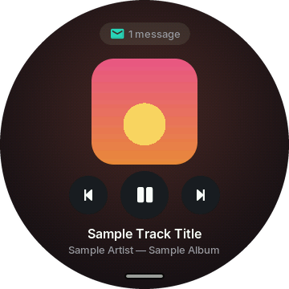
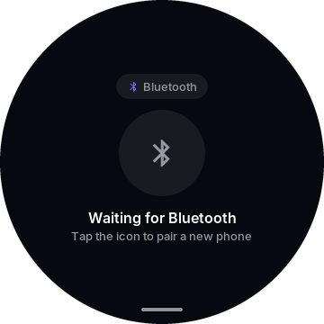
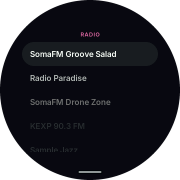
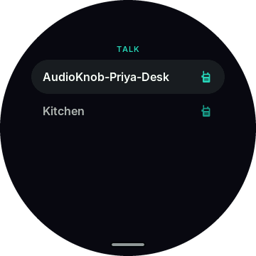
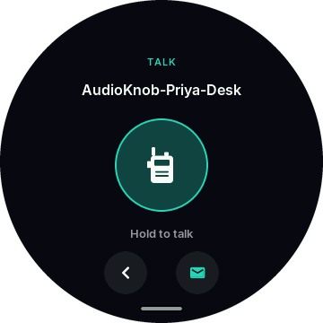
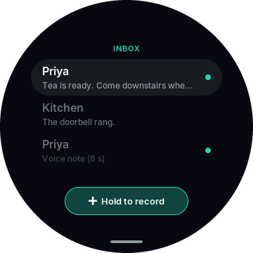
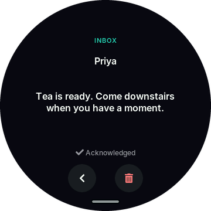
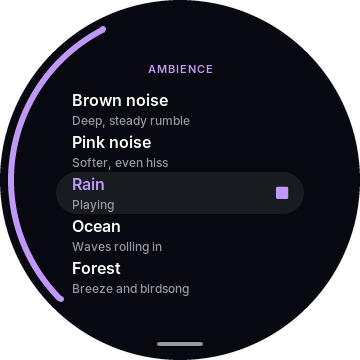

# AudioKnob

Firmware that turns the [Waveshare ESP32-S3-Knob-Touch-LCD-1.8](https://www.waveshare.com/) into a desk speaker first and a desk companion second: a wireless audio front-end with a round touch display, a rotary knob, and a handful of small desk apps.

<p align="center">
  
  
  
</p>

## Features

- **AirPlay 2 and AirPlay 1 receiver** (ESP32-S3), with title/artist metadata, artwork and volume/play-pause sent back to the sender. The now-playing screen takes its colour from the cover art.
- **Bluetooth A2DP sink + AVRCP** (ESP32), with the same now-playing view and on-screen pairing confirmation.
- **Internet radio** (MP3/AAC streams, ICY titles), with presets edited from the web page.
- **One source at a time**: a hardware I2S switch routes whichever chip is playing to the PCM5100A DAC; the last source to start wins.
- **Knob and touch UI** built with LVGL: a clock face that puts what's playing first, an app launcher, and apps for radio, Talk, inbox, timer, pomodoro, ambient sounds, stopwatch, weather and settings.
- **LAN Talk and inbox**: hold-to-talk between AudioKnobs on the same network, plus text messages and voice notes kept in an inbox ([docs/lan-talk.md](docs/lan-talk.md)).
- **Ambient sounds**: brown/pink noise, rain, ocean and forest, synthesized live so nothing loops; the pomodoro can play one during focus blocks.
- **Web settings page** at `http://<device-name>.local/` and Wi-Fi setup through a captive portal.
- **OTA updates** for both chips, with rollback.
- **Desktop emulator** of the UI (SDL2), so UI work needs no hardware.

USB-C audio (UAC2) is planned but not implemented.

## Screenshots

Rendered from the desktop emulator, which feeds the UI sample data.

| | | |
|:-:|:-:|:-:|
| <br>Clock face | <br>Paused track | <br>Launcher |
| <br>AirPlay | <br>Bluetooth | <br>Waiting for Bluetooth |
| <br>Radio | <br>Talk | <br>Hold to talk |
| <br>Inbox | <br>Message | <br>Ambience |
| <br>Timer | <br>Pomodoro | <br>Stopwatch |
| <br>Weather | <br>Settings | |

## Architecture

The board has two MCUs, each with its own firmware and PlatformIO environment:

| Chip | Env | Role |
|------|-----|------|
| ESP32-S3 (8 MB PSRAM) | `s3` | UI, Wi-Fi, AirPlay, radio, Talk, mic, SNTP, weather, I2S output, USB |
| ESP32-U4WDH | `esp32` | Classic Bluetooth: A2DP/AVRCP |

They talk over a UART carrying control and metadata only; audio never crosses it. Shared protocol code lives in `firmware/lib/common/`. [docs/spec.md](docs/spec.md) has the hardware facts, pin map and protocol design; [CLAUDE.md](CLAUDE.md) has per-module notes.

## Building

Requires [PlatformIO](https://platformio.org/).

```bash
pio run -d firmware/s3 -e s3 -t upload       # flash the ESP32-S3
pio run -d firmware/esp32 -e esp32 -t upload # flash the ESP32-U4WDH
pio run -d firmware/s3 -e native -t exec     # run the UI on the desktop
```

The native target needs SDL2 (`brew install sdl2` on macOS) and expects Homebrew under `/opt/homebrew`; adjust `build_flags` in `firmware/s3/platformio.ini` otherwise.

Emulator keys: Up/Down (or the mouse wheel) turn the knob, Enter presses it, Esc long-presses it (opens the launcher). Sample data: `P` cycles playback states, `T` toggles an incoming Talk call, `U` sends a sample firmware update, `A` steps the weather's air quality and UV.

Host tests for the Talk protocol and inbox storage: `python3 tests/lan_voice/run.py`.

### Configuration

`sdkconfig.defaults.*` in each firmware project hold the defaults. Wi-Fi credentials are entered on the device (captive portal or web page); the `AK_WIFI_SSID` / `AK_WIFI_PASSWORD` Kconfig options are optional development fallbacks and ship empty. Don't commit real values.

## Repository layout

```
firmware/s3/        ESP32-S3 project (PlatformIO + ESP-IDF, plus the native UI emulator)
  src/ui/             LVGL screens, apps, generated fonts/backgrounds (builds natively too)
  src/device/         hardware-only code: airplay/, radio/, talk/, ambience/, drivers/, net/, core/
  lib/pair_ap/        vendored AirPlay 2 pairing library
firmware/esp32/     ESP32-U4WDH project (Bluetooth)
firmware/lib/common/  UART protocol shared by both
docs/               spec, LAN Talk, flash layout, memory budget, stock firmware notes, screenshots
hardware/           OpenSCAD desk stand
tests/              host tests (LAN Talk protocol and storage, partition table)
tools/              generators for the files in src/ui/assets
```

## License

[MIT](LICENSE). Bundled third-party code and its licenses are listed in [THIRD_PARTY.md](THIRD_PARTY.md).
